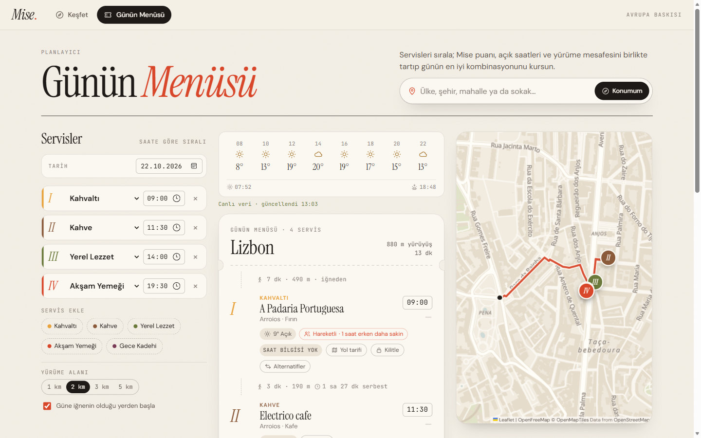
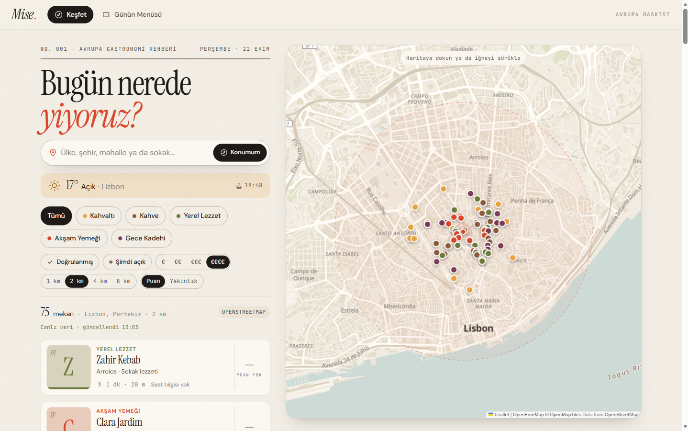

# Mise.

**Your day, *en place*.** A gastronomy route planner for Europe that finds the venues people love and turns
your day into a tasting menu.

[](https://furknsaglk.github.io/mise/)
[](https://github.com/furknsaglk/mise/actions/workflows/ci.yml)
[](LICENSE)


<p align="center">
  
</p>

Pick a place anywhere on the map. Mise collects well-loved cafés, bakeries, restaurants and bars around it and
plans the day course by course — breakfast → coffee → local bites → dinner → a late drink. Instead of choosing
the "best" venue for each course in isolation, it optimizes **the whole day at once**: venue quality, opening
hours on that weekday, total walking distance, hourly weather, sunset and estimated busyness.

**▶ Live demo: [furknsaglk.github.io/mise](https://furknsaglk.github.io/mise/)** — no sign-up, no API keys.
The demo runs entirely in your browser with **fictional venues** (invented names, ratings and reviews, generated
around whatever place you search); place search, the map, weather, sunset and walking routes are real.
See [Live demo](#live-demo).

> **Note:** the user interface is in **Turkish**; code, comments and documentation are in English.
> This is a personal project / prototype — see [Limitations](#limitations).

## Contents

- [Features](#features)
- [How the day planner works](#how-the-day-planner-works)
- [Tech stack](#tech-stack)
- [Live demo](#live-demo)
- [Getting started](#getting-started)
- [Configuration](#configuration)
- [Cost safety](#cost-safety)
- [Data sources & terms compliance](#data-sources--terms-compliance)
- [Project structure](#project-structure)
- [Deployment](#deployment)
- [Limitations](#limitations)
- [Contributing](#contributing)
- [License](#license)

## Features

- **Discover** — search any country, city, neighborhood or street, or drop a pin on the map. Venues are grouped
  by course; filter by verified, open now, price, radius, and sort by score or distance.
- **Mise score** — combines platform ratings with a Bayesian average, so a 5.0 from 3 reviews can't outrank a
  4.7 from 2,000. Strong ratings on two platforms earn a *Verified* badge.
- **Day menu** — enter your courses and times; get an optimized itinerary with pinning, alternatives, a real
  walking route (OSRM) and notes for lateness, free time and "digestive walks".
- **Context layer** — hourly weather (indoor venues in the rain, terraces in the sun), terraces at sunset,
  estimated busyness charts (clearly labeled as estimates).
- **Map cards** — click a marker for the score, a short description and user reviews.
- **Take it with you** — Google Maps (whole route), Apple Maps / Citymapper / Uber (per stop), an `.ics`
  calendar file with "time to leave" reminders, Google Calendar links and a shareable PNG menu card.
- **Quota-aware** — if Google's free daily quota runs out, Mise falls back to Foursquare and shows Google's own
  place card (Places UI Kit) for previously matched venues. No Google content is stored.
- **Installable** — PWA manifest, responsive layout and a dark mode ("late dinner").

<p align="center">
  
</p>

<sub>Screenshots show the keyless OpenStreetMap mode (Lisbon). Map data © OpenStreetMap contributors, tiles by OpenFreeMap / OpenMapTiles.</sub>

## How the day planner works

Because the order of courses is fixed, choosing one venue per course is a **layered shortest-path** problem,
solved exactly with dynamic programming (Viterbi) in [`src/lib/routing/optimizer.js`](src/lib/routing/optimizer.js):

```
total utility = Σ (venue quality + context bonus) − λ · Σ walking distance
```

- *Quality*: Mise score (0–1), or a popularity / prominence signal for unrated venues.
- *Context*: weather at that hour, sunset overlap, estimated busyness.
- *Walking cost*: λ per km, discounted after heavy meals and increased in the rain.
- Venues must be open on arrival and for at least 45 minutes on the plan's weekday.

After the optimal path is found, the real walking route replaces the straight-line estimates and the schedule
(lateness, free time) is recomputed.

## Tech stack

| Layer | Choice |
|---|---|
| Framework | [Next.js 16](https://nextjs.org/) (App Router, Turbopack), React 19, JavaScript |
| Styling | CSS Modules + design tokens ([`src/styles/tokens.css`](src/styles/tokens.css)), dark mode |
| Map | Leaflet + react-leaflet + MapLibre GL, [OpenFreeMap](https://openfreemap.org/) vector tiles recolored in code |
| Data | Google Places API (New), Foursquare Places API, OpenStreetMap (Overpass / Photon), OSRM, Open-Meteo |
| State | `useSyncExternalStore` + `localStorage` (no database) |
| Hosting | [Vercel](https://vercel.com/) (region `fra1`, see [`vercel.json`](vercel.json)) |

## Live demo

[furknsaglk.github.io/mise](https://furknsaglk.github.io/mise/) is a static build of the app, published to GitHub
Pages by [`.github/workflows/pages.yml`](.github/workflows/pages.yml) on every push to `main`.

- **What is fictional:** venues, their names, ratings (from two made-up sources, "Demo A" and "Demo B"), reviews and
  opening hours. They are generated deterministically in the browser around the searched place
  ([`src/lib/demo/venues.js`](src/lib/demo/venues.js)) and never refer to real businesses. A notice in the app says so.
- **What is real:** place search and reverse geocoding (Photon), the map (OpenFreeMap), weather and sunset
  (Open-Meteo), walking routes (OSRM) and the day optimizer itself. Venue positions are checked against Open-Meteo's
  elevation data so they stay on land.
- **No server and no keys:** the demo calls these free, CORS-enabled services directly. Google and Foursquare are
  never contacted.

Build it locally with `npm run build:demo` (output in `out/`, served under `/mise`; set `DEMO_BASE_PATH=` to serve it
from the domain root).

## Getting started

**Requirements:** Node.js 20.9 or newer.

```bash
git clone https://github.com/furknsaglk/mise.git
cd mise
npm install
cp .env.example .env.local    # Windows: copy .env.example .env.local
npm run dev                   # → http://localhost:3000
```

The app works **without any API keys**, using live OpenStreetMap data. Production build: `npm run build && npm start`.

## Configuration

All variables are optional. See [`.env.example`](.env.example) for details and recommended restrictions.

| Variable | Scope | Purpose |
|---|---|---|
| `GOOGLE_PLACES_API_KEY` | Server (secret) | Ratings, reviews, hours, price |
| `FOURSQUARE_API_KEY` | Server (secret) | Popular venues |
| `FOURSQUARE_PREMIUM` | Server | `1` enables Foursquare rating/hours/photo fields (requires account credits) |
| `NEXT_PUBLIC_GOOGLE_MAPS_BROWSER_KEY` | **Browser (public)** | Google Places UI Kit cards |

`NEXT_PUBLIC_*` values are embedded in the client bundle by design. Only use a key that is restricted by API,
HTTP referrer and daily quota (see below).

## Cost safety

Google Places is a paid API. The author's deployment runs at **zero cost** with these Google Cloud settings —
recommended for any fork:

- **Server key:** restricted to `places.googleapis.com`; daily `SearchNearbyRequest` quota ≈ 1/31 of the free
  monthly tier (e.g. 32/day). One search uses 3 requests. Unused Places methods set to 0/day.
- **Browser key:** restricted to `placewidgets.googleapis.com` + `maps-backend.googleapis.com` and to your own
  domain; daily `PlacesUiKitQueryRequest` ≤ 160 and **Map loads = 0** (no Google map is ever created).
- When a quota is reached Google rejects the request instead of billing; the app continues with Foursquare /
  OpenStreetMap and tells the user.
- In code: a per-IP rate limit ([`src/lib/server/rateLimit.js`](src/lib/server/rateLimit.js)) and an in-session
  store that prevents duplicate requests across tabs ([`src/lib/clientCache.js`](src/lib/clientCache.js)).

## Data sources & terms compliance

- **No Google content is cached or stored.** Google's Places policies prohibit caching or storing Places content
  except place IDs. Mise only stores **Google ↔ Foursquare ID pairs** in the browser (`localStorage`); ratings and
  reviews are always fetched live or rendered by Google's own Places UI Kit card.
- **No server-side cache.** Every new search fetches fresh data.
- **Attribution** for Google, Foursquare, OpenStreetMap, OpenFreeMap and Open-Meteo is shown in the UI and on the
  in-app `/credits` page.
- **Busyness is not measured data** — it is an estimation model and labeled as such.
- Third-party photos, fonts and libraries keep their own licenses: see [THIRD_PARTY_NOTICES.md](THIRD_PARTY_NOTICES.md).

## Project structure

```
src/
├── app/                    Pages and API routes (keys stay on the server)
│   ├── api/places/         Venue search (Google + Foursquare → OSM fallback)
│   ├── api/geocode/        Place search / reverse geocoding (Photon)
│   ├── api/route/          Walking route (OSRM)
│   ├── api/weather/        Weather (Open-Meteo)
│   ├── api/photo/          Google photo proxy
│   ├── plan/               Day menu page
│   └── credits/            Attributions page
├── components/
│   ├── map/                Map canvas, vector basemap, venue popup
│   ├── venues/             Explorer, filters, venue card, reviews, Google place card
│   ├── planner/            Planner, course builder, itinerary, plan map
│   ├── integrations/       Export panel, per-stop directions
│   ├── insights/           Weather strip, busyness bars, quota notice
│   └── ui/                 App shell, ticket, buttons, badges, icons
├── hooks/                  useVenues, useWeather, usePlan, useWalkingRoute, …
├── lib/
│   ├── providers/          google.js, foursquare.js, osm.js, index.js (source merging)
│   ├── services/           Photon, Open-Meteo, OSRM clients (shared by API routes and the demo)
│   ├── demo/               Fictional venue generator for the keyless demo build
│   ├── routing/            distance.js, optimizer.js
│   ├── scoring/            miseScore.js
│   ├── integrations/       deepLinks.js, calendar.js (.ics), shareCard.js, share.js
│   ├── insights/           busyness.js (estimation model)
│   └── …                   time, weather codes, plan store, client cache, URL sanitizing
└── styles/tokens.css       Colors, fonts, sizes
public/photos/              Category photos (Wikimedia Commons, see THIRD_PARTY_NOTICES.md)
scripts/                    Build helpers (MapLibre web worker copy, static demo build)
```

## Deployment

The app is designed for Vercel:

```bash
npx vercel login
npx vercel deploy --prod
```

Define the environment variables under *Project → Settings → Environment Variables*. Vercel does not allow
`NEXT_PUBLIC_*` variables to be marked as secret, because they are public by nature.

The keyless demo is deployed separately to GitHub Pages (see [Live demo](#live-demo)); in a fork, enable it under
*Settings → Pages → Source: GitHub Actions*.

## Limitations

- Google ↔ Foursquare ID matches live only in the browser that collected them; while Google's quota is exhausted,
  Google cards appear only for previously matched venues.
- While the quota is exhausted, the list and map markers show no numeric scores and the planner ranks by popularity.
- Foursquare's free tier has no ratings, hours or photos.
- Plans are stored only in the browser (no accounts or cross-device sync).
- The free public services used (OSRM demo server, Photon, Open-Meteo) have fair-use policies; Open-Meteo requires a
  subscription for commercial use.
- No automated tests yet; CI verifies that the app and the static demo build.

## Contributing

Contributions are welcome — please read [CONTRIBUTING.md](CONTRIBUTING.md) and the
[Code of Conduct](CODE_OF_CONDUCT.md). Report security issues privately as described in [SECURITY.md](SECURITY.md);
**never paste API keys into issues or pull requests.**

## License

The source code is released under the [MIT License](LICENSE). Photos, fonts, map data and dependencies are licensed
separately — see [THIRD_PARTY_NOTICES.md](THIRD_PARTY_NOTICES.md) (photos are Creative Commons; `react-leaflet` uses
the Hippocratic License 2.1).
